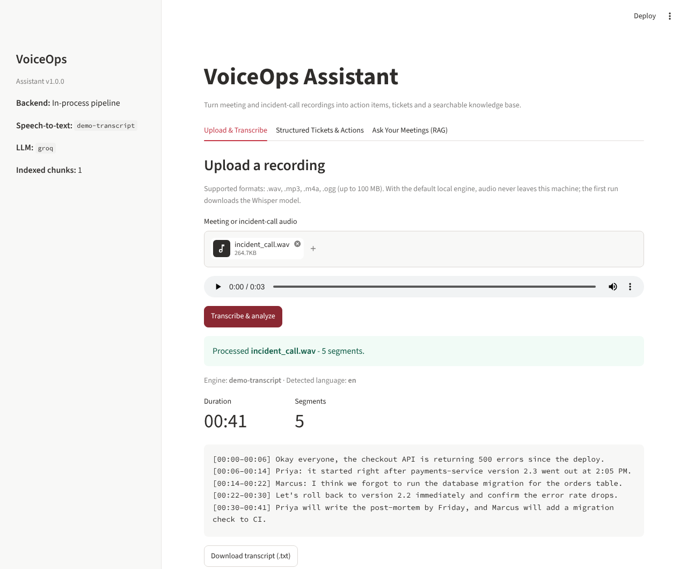
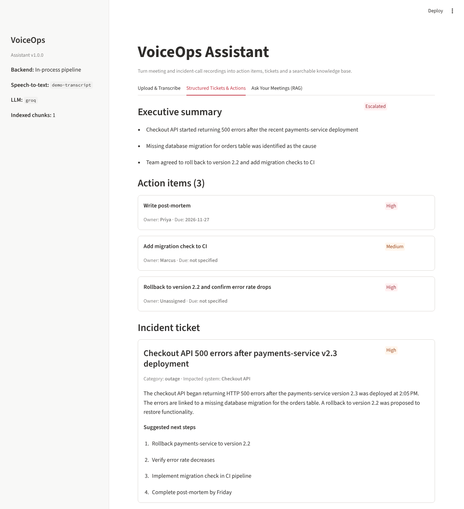
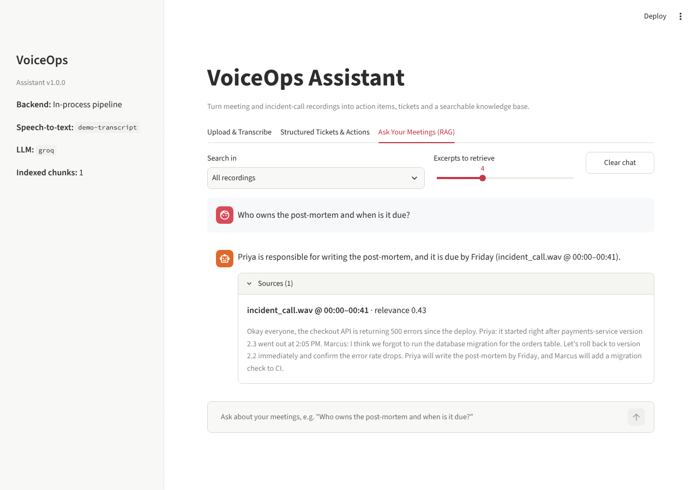
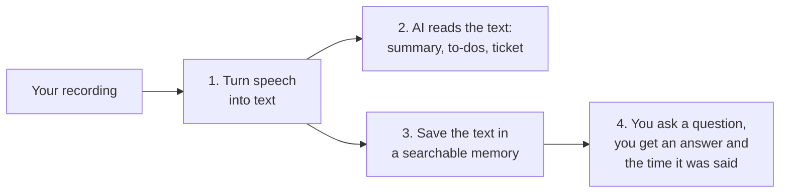

# VoiceOps Assistant

**Turn a recording of a meeting or phone call into a to-do list, a ready-to-file ticket, and a memory you can chat with. It is free to run.**

Drop in an audio file. VoiceOps listens to it and gives you back:

- the **written transcript**, with the time each thing was said
- a **3-line summary**, and the mood of the call (calm or heated)
- an **action list**: who needs to do what, and by when
- a **ticket** you can paste into Jira (for incident and outage calls)
- a **chat** where you can ask *"Who owns the post-mortem?"* and get an answer that also tells you *where in the call* it was said, such as `incident_call.wav @ 00:22–00:41`

## See it in action

**1. Upload a recording and read the transcript**



**2. Get the summary, the to-do list and the ticket**



**3. Ask questions about your calls**



> **About these screenshots:** they use a ready-made sample transcript instead of the speech-recognition step, and a simplified search index (so the "relevance" number is not typical). The screens, summary, ticket and answers are the real app and a real free AI model.

## Try it in 3 steps

You need Python 3.10 or newer. Download this project, then open a terminal in its folder.

**Step 1. Install it.**

```bash
python3 -m venv .venv
source .venv/bin/activate        # on Windows: .venv\Scripts\activate
pip install -r requirements.txt
```

**Step 2. Add a free AI key** (recommended). Without one you still get the transcript and search, but no summary, ticket or written answers. See [Do I need a key?](#do-i-need-a-key) below.

```bash
cp .env.example .env
```

Open the new `.env` file and paste your key after `GOOGLE_API_KEY=` or `GROQ_API_KEY=`.

**Step 3. Start the app.**

```bash
streamlit run app/ui.py
```

Open the address it prints (usually <http://localhost:8501>), upload a recording, and press **Transcribe & analyze**.

> **The first time,** the app downloads two small models, about 240 MB in total, and then keeps them. Your first recording takes a minute or two longer, and you need an internet connection for that download.

## Do I need a key?

| What you want | Without a key | With a free key |
|---|---|---|
| Transcript with times | Yes | Yes |
| Search your past calls (shows the matching parts) | Yes | Yes |
| Summary, mood, action list and ticket | No | Yes |
| Chat answers written as full sentences | No | Yes |

You only need **one** of these free keys (no credit card):

- **Google Gemini:** <https://aistudio.google.com/apikey> (paste it as `GOOGLE_API_KEY`)
- **Groq:** <https://console.groq.com/keys> (paste it as `GROQ_API_KEY`)

If you add both, the app uses Google first and switches to Groq if Google has a problem.

**Privacy:** the speech is turned into text **on your own computer**, so your audio is not uploaded. The *text* of the call is sent to the AI service you chose, to write the summary. Free plans can have different data rules from paid plans, so read their terms before using a sensitive recording.

## How it works



1. **Speech into text.** A speech-recognition model called Whisper runs on your computer and writes down what was said, with times.
2. **The AI reads it.** A free AI service reads the text and fills in the summary, to-do list and ticket in a fixed format, so other tools can use it.
3. **Searchable memory.** The text is cut into small pieces and saved on your computer, so you can search by meaning and not only by exact words.
4. **Ask and answer.** When you ask a question, the app finds the best pieces, the AI answers using only those, and the app shows you where they came from.

If the AI is unavailable (no key, or the free plan ran out), you still get the transcript and the search. Nothing is thrown away.

## Who is it for?

- **Incident and outage calls:** get a ticket and a searchable timeline for the post-mortem.
- **Customer support escalations:** every promise made on the call becomes a to-do with an owner.
- **Team meetings:** send action items to Jira or a spreadsheet automatically.
- **Customer and sales calls:** ask later, *"What did they say about pricing?"*

## Good to know

- **No password on the API.** It is built for learning and demos. Do not put it on the open internet as it is.
- **Free AI plans have limits.** If you hit them, wait a bit or add the second key. Gemini copes better with very long recordings.
- **AI can make mistakes.** Read a ticket before you file it.
- **The automated tests use stand-ins** for the speech and search models, so they can run offline. Try one real recording on your own computer to see the full thing work.

---

## More details

Everything below is optional. Click a title to open it.

<details>
<summary><b>Plain-English word list</b></summary>

| Word | What it means |
|---|---|
| **Transcript** | The call written out as text. |
| **Speech-to-text** | Software that turns speech into text. Here it is Whisper (on your computer) or, if you choose, AssemblyAI (online). |
| **AI model (LLM)** | The AI service (Gemini or Groq) that reads the transcript and writes the summary and answers. |
| **RAG** | "Search first, then answer." The app finds the relevant parts of your calls, then asks the AI to answer using only those parts. This keeps answers tied to what was really said. |
| **Embeddings and vector database (ChromaDB)** | A way to save text as numbers so it can be searched by meaning. It is stored in a `chroma_db` folder on your computer. |
| **JSON** | A plain-text format for structured data that most tools understand. |
| **Webhook** | A web address that another tool (such as n8n or Zapier) listens on. You send it the result, and it can start an action, like creating a Jira ticket. |
| **VAD (voice activity detection)** | Skips the silent parts, so transcription is faster and Whisper does not invent or repeat sentences. |
| **int8** | A compact number format that lets the speech model run quickly on an ordinary computer, with no graphics card. |
| **Speaker labels (diarization)** | Marking who is speaking ("Speaker A"). Only available when you use AssemblyAI. |

</details>

<details>
<summary><b>Settings you can change</b></summary>

Settings live in the `.env` file. `.env.example` lists all of them with comments.

| Setting | Default | What it does |
|---|---|---|
| `GOOGLE_API_KEY` | none | Your free Gemini key. Used first. |
| `GROQ_API_KEY` | none | Your free Groq key. The backup, or the main one if it is your only key. |
| `LLM_PROVIDER` | `auto` | `auto` (Gemini, then Groq), `gemini`, or `groq`. |
| `GEMINI_MODEL` / `GROQ_MODEL` | `gemini-2.5-flash` / `openai/gpt-oss-120b` | Which AI model to use. AI companies retire models over time; if you see "model not found", put a current model name here. |
| `WHISPER_MODEL_SIZE` | `base` | `tiny`, `base`, `small`, `medium` or `large-v3`. Bigger is slower but more accurate. Try `small` for noisy calls. |
| `STT_PROVIDER` / `ASSEMBLYAI_API_KEY` | `local` / none | Set `STT_PROVIDER=assemblyai` and add a key to use the online speech service instead. It adds speaker labels. |
| `STT_LANGUAGE` | auto | A hint such as `en` or `de`. |
| `MAX_UPLOAD_MB` | `100` | The biggest file the app will accept. |
| `RAG_TOP_K` | `4` | How many pieces of past calls are looked at for each question. |
| `CHROMA_DIR` | `./chroma_db` | Where the searchable memory is saved. |
| `VOICEOPS_API_URL` | none | Makes the screen talk to a separately running API (see the next section). |

</details>

<details>
<summary><b>Run it as two programs (API + screen)</b></summary>

By default the screen does the work itself. You can also run the API on its own, and let the screen talk to it:

```bash
# Terminal 1: the API
uvicorn app.api:app --port 8000

# Terminal 2: the screen, using that API
VOICEOPS_API_URL=http://localhost:8000 streamlit run app/ui.py
```

The API's built-in help page is at <http://localhost:8000/docs>.

| Method | Address | What it does |
|---|---|---|
| `GET` | `/api/health` | Shows the status and settings. Never shows your keys. |
| `POST` | `/api/process-audio` | Send an audio file (form field `file`). It transcribes, summarises and saves it. |
| `POST` | `/api/ask` | Ask a question about your saved calls and get an answer with sources. |
| `GET` | `/api/sources` | Lists the recordings that can be searched. |

```bash
# Process a recording
curl -F "file=@incident_call.wav" http://localhost:8000/api/process-audio

# Ask a question (you can also add "source_file" and "top_k")
curl -X POST http://localhost:8000/api/ask \
  -H "content-type: application/json" \
  -d '{"question": "Who owns the post-mortem and when is it due?"}'
```

**Replies from `/api/process-audio`:** `200` worked (check `warnings`), `400` empty file, `413` file too big, `415` file type not allowed (use `.wav`, `.mp3`, `.m4a` or `.ogg`), `422` no speech found or the audio could not be read.

**Upload safety:** only the four audio types are accepted, there is a size limit, the uploaded file is stored under a random name, and it is always deleted afterwards.

</details>

<details>
<summary><b>Sample output</b></summary>

This is real output from a short made-up incident call.

**From `/api/process-audio`** (the transcript is left out here; the screen can include it with a switch):

```json
{
  "event": "voiceops.meeting.processed",
  "schema_version": "1.0",
  "source_file": "incident_call.wav",
  "processed_at": "2026-11-23T09:45:40.018672Z",
  "analysis": {
    "executive_summary": [
      "Checkout API returning 500 errors after recent deployment",
      "Missing database migration for orders table identified as cause",
      "Rollback to version 2.2 and add migration check to CI planned"
    ],
    "sentiment": "escalated",
    "action_items": [
      {
        "task": "Roll back checkout API to version 2.2 and confirm error rate drops",
        "owner": "Unassigned",
        "due_date": null,
        "priority": "high"
      },
      {
        "task": "Write post-mortem for the incident",
        "owner": "Priya",
        "due_date": "2026-11-27",
        "priority": "medium"
      },
      {
        "task": "Add migration check to CI pipeline",
        "owner": "Marcus",
        "due_date": null,
        "priority": "medium"
      }
    ],
    "incident_ticket": {
      "title": "Checkout API 500 errors after payments-service v2.3 deployment",
      "severity": "high",
      "category": "outage",
      "impacted_system": "Checkout API",
      "description": "The checkout API began returning 500 errors immediately after the payments-service version 2.3 deployment at 2:05 PM. The issue was traced to a missing database migration for the orders table. Rolling back to version 2.2 is planned to restore service.",
      "suggested_next_steps": [
        "Roll back checkout API to version 2.2",
        "Verify error rate decreases",
        "Add migration check to CI pipeline",
        "Complete post-mortem by Friday"
      ]
    }
  },
  "indexed_chunks": 2,
  "warnings": []
}
```

- `due_date` is a date like `2026-11-27`, or `null` if none was said. "By Friday" was turned into a date using the day of processing (a Monday).
- `incident_ticket` is `null` when the call is not about an incident.
- `severity` is `low`, `medium`, `high` or `critical`. `priority` is `low`, `medium` or `high`. `sentiment` is `positive`, `neutral` or `escalated`.

**From `/api/ask`:** (the relevance numbers here come from a simplified demo search; the real search model gives different numbers)

```json
{
  "question": "Who owns the post-mortem and when is it due?",
  "answer": "Priya is responsible for writing the post-mortem, and it is due by Friday (incident_call.wav @ 00:22–00:41).",
  "citations": [
    {
      "source_file": "incident_call.wav",
      "start_time": 22.5,
      "end_time": 41.0,
      "snippet": "Let's roll back to version 2.2 immediately and confirm the error rate drops. Priya will write the post-mortem by Friday, and Marcus will add a migration check to CI.",
      "score": 0.4108
    },
    {
      "source_file": "incident_call.wav",
      "start_time": 0.0,
      "end_time": 22.5,
      "snippet": "Okay everyone, the checkout API is returning 500 errors since the deploy. Priya: it started right after payments-service version 2.3 went out at 2:05 PM. Marcus: I think we forgot to run the database migration for the orders table.",
      "score": 0.3266
    }
  ],
  "answer_source": "llm"
}
```

`answer_source` tells you how the answer was made: `llm` (written by the AI), `extractive` (the AI was unavailable, so you get the matching excerpts instead), or `no_data` (nothing saved yet, or nothing matched).

**If no AI key is set,** you still get the transcript, and a warning explains why there is no summary (shortened):

```json
{
  "event": "voiceops.meeting.processed",
  "source_file": "incident_call.wav",
  "analysis": null,
  "indexed_chunks": 2,
  "warnings": [
    "No LLM configured - summary, action items and ticket were skipped. Set GOOGLE_API_KEY or GROQ_API_KEY in .env (both have free tiers)."
  ]
}
```

</details>

<details>
<summary><b>Send results to Jira, n8n or Google Sheets</b></summary>

The result is plain JSON with a fixed layout (`event`, `schema_version`), so other tools can read it without changes. In the screen, the **Structured Tickets & Actions** tab has a copy button and a download button for it.

**n8n, Zapier or Make:** send the result to a webhook address.

```bash
curl -s -F "file=@incident_call.wav" http://localhost:8000/api/process-audio \
  | curl -s -X POST "$N8N_WEBHOOK_URL" -H "content-type: application/json" -d @-
```

**Jira:** a good way to match the fields of `analysis.incident_ticket`:

| Ticket field | Jira field |
|---|---|
| `title` | Summary |
| `description` and `suggested_next_steps` | Description (Jira Cloud wants a special format called Atlassian Document Format, so convert the text first) |
| `severity` | Priority (`critical` to Highest, `high` to High, and so on) |
| `category`, `impacted_system` | Labels or Components |

**Google Sheets:** add one row for each entry in `analysis.action_items` (`task`, `owner`, `due_date`, `priority`), plus `source_file`.

</details>

<details>
<summary><b>Something went wrong?</b></summary>

| What you see | What it means, and what to do |
|---|---|
| `TypeError: open() got an unexpected keyword argument 'metadata_errors'` | A helper library (PyAV) is too new for the speech model. Run `pip install "av<19"`. (`requirements.txt` already does this.) |
| `Could not load the faster-whisper 'base' model ... huggingface.co` | The speech model is downloaded the first time, and your computer could not reach the download site. Check your internet or proxy and try again. The search model works the same way. |
| No summary or ticket, and a warning mentions `GOOGLE_API_KEY` | You have not added an AI key yet (step 2). The transcript and search still work. |
| `404` or "model not found" from Gemini or Groq | The company retired that AI model. Set `GEMINI_MODEL` or `GROQ_MODEL` in `.env` to a current one from their website. |
| `429` or "rate limit" | You used up the free plan for now. Wait a minute, add the second key, or use a shorter recording. |
| Transcription is very slow | Set `WHISPER_MODEL_SIZE=tiny`, or use `STT_PROVIDER=assemblyai`. The very first run also includes the model download. |
| The install is several gigabytes | See "Smaller install" below. |

</details>

<details>
<summary><b>Smaller install (no graphics card)</b></summary>

The search model needs PyTorch, and by default pip downloads a large version meant for graphics cards. If you have no graphics card, install the small version first:

```bash
pip install torch --index-url https://download.pytorch.org/whl/cpu
pip install -r requirements.txt
```

</details>

<details>
<summary><b>Run the tests</b></summary>

```bash
pytest
```

There are 185 checks. They need **no internet, no API keys and no audio files**, and the test setup blocks internet access to prove it. They cover:

- the data formats, including messy AI answers (such as `URGENT` instead of `high`)
- speech-to-text, using stand-ins for the models, plus a real check that the audio reader opens `.wav`, `.mp3`, `.m4a` and `.ogg` files
- the AI step: how requests are built (with the real Gemini and Groq libraries), retries, and switching to the backup
- the searchable memory, using a real ChromaDB database
- the API, including unsafe file names and cleanup of uploaded files
- the screen, by running the real Streamlit app in a test

</details>

<details>
<summary><b>What is inside the project</b></summary>

```
voiceops-assistant/
├── app/
│   ├── config.py        # settings, read from .env
│   ├── schemas.py       # the shapes of all data: transcripts, action items, tickets, answers
│   ├── stt_engine.py    # speech-to-text: Whisper (default) or AssemblyAI
│   ├── extractor.py     # talks to Gemini / Groq and builds the summary, to-dos and ticket
│   ├── rag_store.py     # the searchable memory, and answers with sources
│   ├── pipeline.py      # runs the steps in order: transcribe, summarise, save
│   ├── client.py        # lets the screen use the pipeline directly or through the API
│   ├── api.py           # the API (FastAPI)
│   └── ui.py            # the screen (Streamlit)
├── tests/               # the automated checks
├── docs/images/         # the screenshots in this README
├── .env.example         # a template for your settings
├── requirements.txt     # the libraries to install
└── README.md
```

</details>

<details>
<summary><b>Why it is built this way</b></summary>

- **Free and local first.** Speech recognition and search run on your computer. Only the AI step needs the internet, and it is optional.
- **Silence is skipped.** This makes transcription faster and stops Whisper from inventing or repeating sentences.
- **A fixed format, with some forgiveness.** The AI's answer must fit a set layout. Small slips, like `URGENT` for `high`, are fixed automatically. Real mistakes trigger one retry in which the AI is told what was wrong.
- **What was said on a call is treated as data, never as orders.** Someone saying "ignore your rules" on a recording cannot take over the AI.
- **Every answer shows its source,** so you can check it against the recording.
- **Nothing is lost if the AI fails.** You still get the transcript and the search.

</details>
